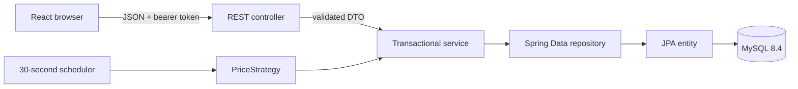

# Architecture and trade rules

This is an educational simulator. Every balance and trade uses virtual INR, every stock price is simulated, and there is no payment or brokerage integration.

## Request flow



Controllers translate HTTP requests into service calls. Services own business rules and transaction boundaries. Repositories own persistence and SQL queries. Entities protect their state with business methods. DTOs keep the database model, password hash, and lazy relationships out of JSON responses.

The backend packages are `controller`, `service`, `repository`, `entity`, `dto`, `exception`, `config`, `scheduler`, and `strategy`. `SimulatorApplication` starts Spring Boot. The frontend keeps pages, reusable components, API calls, and styles in their respective directories.

## Six-table model

| Table | Responsibility | Important constraint |
| --- | --- | --- |
| `users` | Name, normalized email, password hash | Unique email |
| `wallets` | Available virtual INR and optimistic version | One wallet per user |
| `stocks` | Unique symbol, name, current simulated price | Positive decimal price |
| `holdings` | Quantity and average acquisition price per stock | Unique `(user_id, stock_id)` |
| `transactions` | Immutable BUY, SELL, and DEPOSIT records | Deposit has no stock |
| `price_history` | Timestamped stock prices | Index `(stock_id, recorded_at)` |

`BaseEntity` supplies generated identity and creation time. Foreign keys preserve references. The transaction index `(user_id, created_at)` supports recent activity and paging. `DECIMAL(15,2)` stores money and prices; holding quantities use `DECIMAL(15,4)`. `BigDecimal` carries these values through Java without binary floating-point arithmetic.

This design separates independent facts: a user's identity, wallet balance, catalog stock, current position, immutable trade, and historical price. Repeating the stock name in every holding or the user's email in every transaction would create update anomalies. A holding's average acquisition price is a deliberate stored summary, maintained in the same transaction as each trade.

## Authentication and authorization

Registration validates name, email, and password, stores a BCrypt hash, creates a ₹1,000 wallet atomically, and returns a signed token. Login accepts email and password. Requests for a wallet, portfolio, transaction history, or trade must carry that user's token. A supplied `userId` is checked against the authenticated principal; knowing another ID is insufficient to read or mutate their account. Public stock data and the classroom leaderboard contain no password hashes or bearer tokens.

JWT signing material comes from `JWT_SECRET`. Local startup generates it; deployed environments must inject it securely. Do not store it in Git, browser screenshots, logs, API examples, or saved setup instructions. The UI stores the session token locally; this keeps the demonstration simple. A production deployment should evaluate HttpOnly cookies, CSRF protection for cookie authentication, token revocation, rate limiting, and a content security policy.

## Buy and sell calculations

A buy request contains `userId`, `stockId`, and an INR amount from ₹10 to ₹500, with at most two decimal places. Quantity is `amount / currentPrice`, rounded to four decimal places with `HALF_UP`. The exact requested amount is debited and recorded; quantity rounding can therefore introduce a small difference between cost and instantaneous marked value.

The new average price is:

```text
newQuantity = oldQuantity + purchasedQuantity
averageBuyPrice = (oldQuantity × oldAveragePrice + purchasedQuantity × tradePrice)
                  / newQuantity
```

The average is stored at two decimal places with `HALF_UP`. Selling accepts a positive quantity with at most four decimal places, requires sufficient holdings, and credits `quantity × currentPrice`, rounded to two decimal places. Partial sells retain the average acquisition price of the remaining position. A full sell removes the zero-quantity holding. Deposits increase virtual balance and create a DEPOSIT transaction; they do not represent investment profit.

## Atomicity, isolation, and concurrency

Buy and sell service methods run inside one database transaction at `READ_COMMITTED`. A trade validates ownership, reads the wallet and price, checks the rule, changes the wallet and holding, then records the trade. These steps commit together. An exception rolls the entire operation back, so a failed debit cannot leave a holding or transaction behind.

`Wallet.version` uses JPA `@Version`. Every balance update checks the version that was read. If two requests read the same wallet state, only one update can commit; the stale update rolls back and returns HTTP 409. Lock the wallet through its version even for trades on different stocks because all positions share that balance. The unique holding constraint also protects the first concurrent purchase of the same stock. A client receiving 409 should refresh wallet and prices before deliberately resubmitting; blindly replaying financial operations is unsafe.

`READ_COMMITTED` avoids dirty reads. It does not, by itself, prevent lost updates; the version check supplies that guarantee. This keeps the teaching example readable without serializing every user's trades globally. Application-level invariants and database constraints remain necessary.

The ACID properties map directly to a trade:

- **Atomicity:** wallet, holding, and transaction row commit or roll back together.
- **Consistency:** positive quantities, sufficient funds/holdings, unique positions, and foreign keys preserve valid state.
- **Isolation:** committed reads plus optimistic version checks prevent a stale wallet overwrite.
- **Durability:** once MySQL commits, its transaction log provides persistence according to the server's durability configuration.

## Prices and reporting

`PriceStrategy.nextPrice(BigDecimal)` abstracts price generation. `RandomWalkStrategy` varies each stock by up to ±2%; `TrendStrategy` provides an alternative implementation. Constructor injection chooses the implementation without changing the scheduler. Every 30 seconds the scheduler updates each stock and appends a history row inside a transaction. Prices are always positive; history uses server timestamps in UTC. Demo fixtures include eight synthetic daily samples per stock for initial charts; subsequent samples come from actual scheduler ticks.

Each position's `holding.quantity × stock.current_price` is rounded to two money decimals, then summed for portfolio value. The same per-position rounding applies to `holding.quantity × holding.avg_buy_price` for current invested cost. Unrealized P&L is their difference. A portfolio with zero invested cost has a P&L percentage of zero, avoiding division by zero.

Leaderboard returns use total wealth, including cash and holdings. The capital baseline is ₹1,000 plus all subsequent deposits. Profit is `wealth − baseline`, and profit percentage is `100 × profit / baseline`. This includes realized results and avoids treating a deposit as a gain. SQL `RANK()` assigns equal rank to equal percentages, leaving a gap after ties. The SQL examples explain the same formula independently of JPA.

Three repository `@Query` methods demonstrate these concepts in executable application code: `HoldingRepository.findPortfolioValue` uses joins and `SUM`, `UserRepository.findUsersWithAboveAverageWalletBalance` uses an average-balance subquery, and `UserRepository.findLeaderboard` uses a native MySQL CTE and `RANK`. The subquery is an interview repository example rather than a separate public HTTP endpoint. The full workbook also includes `GROUP BY`/`HAVING`, `LAG`, top-five gainers, and `EXPLAIN`.

## Errors and validation

All request DTOs use Bean Validation. Every API error has `timestamp`, `status`, `error`, `message`, and `path`; server stack traces are excluded. Missing resources use 404, invalid JSON and business rules use 400, unauthenticated calls use 401, another user's resource uses 403, and an optimistic concurrency conflict uses 409. The client should preserve its form values and show the returned message.

The unchecked `SimulatorException` hierarchy enables automatic transaction rollback for expected business failures. The owner-only `GET /api/transactions/{userId}/export` endpoint exports CSV through `TransactionService.exportCsv`, whose checked `SimulationExportException` demonstrates the compiler's handling requirement. Its `try/catch/finally` example flushes output, translates I/O failures, and closes the writer; normal resource cleanup should use try-with-resources when a resource implements `AutoCloseable`.

## Validation boundaries and deployment limits

Service unit tests verify buy/sell calculations, balances, holdings, and stale update handling. Database integration tests verify real rollback, ownership, constraints, and concurrent requests. Frontend lint/build and browser tests verify the visible flows. Documentation in [API_TESTS.md](API_TESTS.md) provides a reproducible manual sequence.

`ddl-auto=update` meets the project requirement and suits local development. Production should use reviewed Flyway or Liquibase migrations, database backups, TLS, explicit secret rotation, health monitoring, and one elected price scheduler when running multiple backend instances. A classroom leaderboard should also be reviewed for the identity information it exposes before public deployment.
